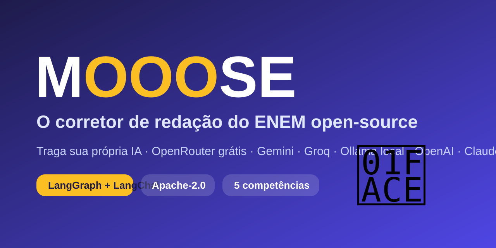

<p align="center"></p>

# 🫎 Mooose — the open-source ENEM essay grader

**Mooose** grades essays for **ENEM** (Brazil's national high-school exam) across its 5 official competencies (0–200 each) and tells students *how to improve*. It is fully open source: **bring your own LLM** (OpenRouter free models, Gemini free tier, Groq, local Ollama, OpenAI, Claude, any OpenAI-compatible API) and grade for free.

> Independent project, **not affiliated with INEP/MEC**. Scores are AI estimates for practice.

## Why it's interesting for AI engineers
- **LangGraph pipeline**: theme analysis → 5 parallel specialist graders → senior-reviewer audit → deterministic calibration → synthesis ([architecture](docs/ARCHITECTURE.md)).
- **Provider-agnostic structured output**: JSON-in-prompt + Pydantic validation + one repair retry, so it works on free/local models without tool-calling.
- **Self-consistency**: N samples per competency, median wins; divergence is surfaced as a warning.
- **Hybrid LLM + rules**: C5 is graded by feature extraction (agent/action/means/purpose/detail) with the score computed in code; INEP annulment rules and tangency caps are plain, unit-tested Python.
- **Prompt-injection hardening**: essay text is delimited and treated as data.
- **Offline tests** with a scripted fake LLM + an [eval harness](backend/evals) (in-range rate, MAE, run-to-run stability) with optional LangSmith tracing.
- **BYOK, stateless API** with SSE progress streaming (`POST /v1/grade/stream`).

## Quick start
```bash
git clone https://github.com/matheussilvano/mooose && cd mooose
docker compose up --build        # UI http://localhost:8080/aberto · API http://localhost:8000/docs
```
or run `uvicorn mooose_api.app:app` in `backend/` and `npm run dev` in `frontend/`.

## About subscriptions
ChatGPT Plus / Claude Pro don't include API access and using their logins in third-party apps violates the providers' terms, so Mooose doesn't do that. Use the free options instead — see [docs/PROVIDERS.md](docs/PROVIDERS.md).

## Contributing & support
See [CONTRIBUTING.md](CONTRIBUTING.md). Star the repo, sponsor via GitHub Sponsors, or send a PR. License: [Apache-2.0](LICENSE) (name and logo excluded, see [NOTICE](NOTICE)).
