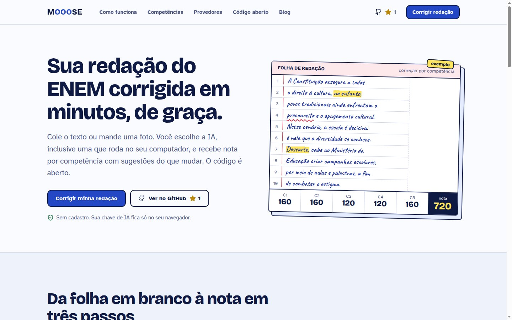
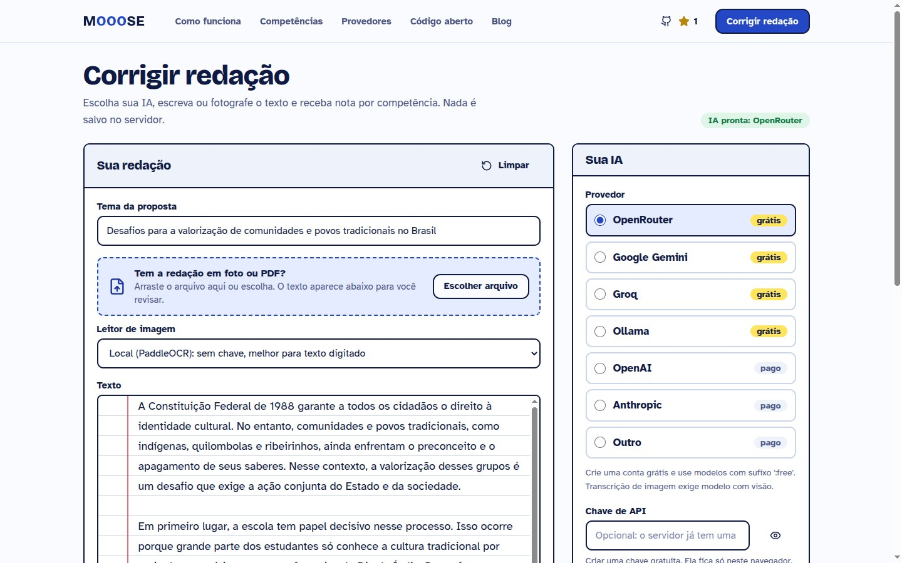
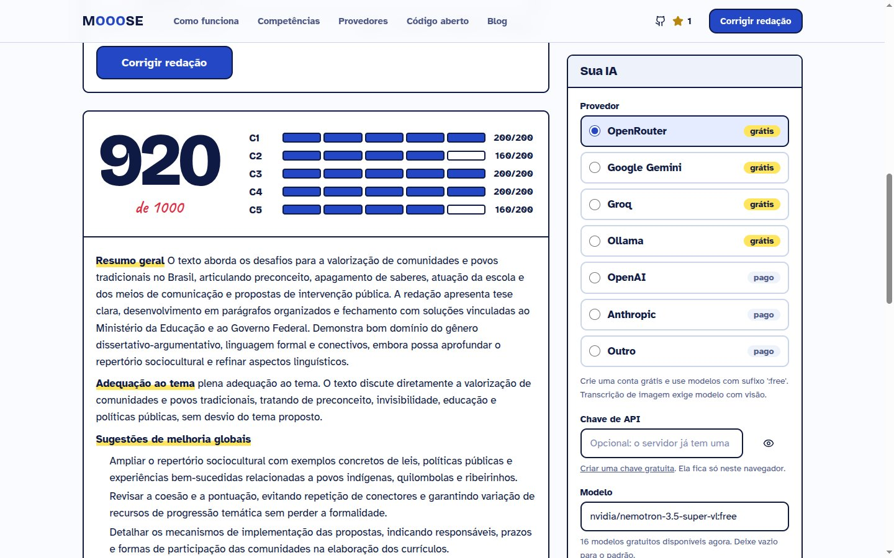

<p align="center">
  <a href="LICENSE"></a>
  <a href="https://github.com/matheussilvano/mooose/actions/workflows/ci.yml"></a>
  
  
  
  <a href="README.en.md"></a>
</p>

# 🫎 Mooose — corretor de redação do ENEM, open-source

<p align="center"><b><a href="https://mooose.matheussilvano.workers.dev">Página do projeto</a></b> · <a href="#-rodando-em-2-minutos">Rodar</a> · <a href="CONTRIBUTING.md">Contribuir</a> · <a href="https://github.com/sponsors/matheussilvano">Apoiar</a></p>

**Mooose** corrige redações no padrão do **ENEM** (as 5 competências, notas de 0 a 200 cada) e explica *como melhorar*. Agora é **100% open-source**: você roda o código, **traz a sua própria IA** e não paga mensalidade para ninguém — dá para corrigir **de graça**.

> ⚠️ Projeto independente, **sem vínculo com o INEP/MEC**. A nota é uma *estimativa* de IA para estudo, não uma nota oficial.

<p align="center">
  
</p>
<table>
  <tr>
    <td></td>
    <td></td>
  </tr>
  <tr>
    <td align="center"><sub>Escolha sua IA (grátis ou não), envie foto ou texto</sub></td>
    <td align="center"><sub>Nota por competência com feedback acionável</sub></td>
  </tr>
</table>

## ✨ O que tem aqui

- 🧠 **Pipeline de IA com LangGraph**: 5 corretores especialistas (um por competência) rodando em paralelo, revisor de segundo parecer, calibração determinística e síntese do feedback. [Entenda a arquitetura →](docs/ARCHITECTURE.md)
- 🔑 **Traga sua IA (BYOK)**: OpenRouter (modelos grátis), Google Gemini (chave grátis), Groq (grátis), **Ollama (local, sem internet)**, OpenAI, Claude ou qualquer API compatível com OpenAI. [Guia dos provedores →](docs/PROVIDERS.md)
- 🎯 **Fiel às regras do ENEM**: notas só em `0/40/80/120/160/200`, fuga total ao tema/texto curto/não dissertativo zeram, tangenciamento limita C2/C3, C5 pontuada por checklist (agente, ação, meio, finalidade, detalhamento).
- 📊 **Mais estável**: opção de amostrar N vezes cada competência e usar a mediana (*self-consistency*).
- 📷 Aceita **texto, foto e PDF**. Foto: modelo de visão da sua IA (melhor para letra manuscrita; há modelos de visão grátis) ou **PaddleOCR local** (sem chave, bom para texto digitado). Você revisa a transcrição antes de corrigir.
- 🧪 **Avaliável**: testes sem rede (LLM falso) e [harness de evals](backend/evals) para medir a qualidade contra redações corrigidas por humanos.
- 🔒 **Privacidade**: sua chave fica só no seu navegador e vai por request; o servidor não guarda chave nem redação.

## 🚀 Rodando em 2 minutos

### Opção A — Docker
```bash
git clone https://github.com/matheussilvano/mooose && cd mooose
docker compose up --build
# app: http://localhost:8080/corrigir   ·   API: http://localhost:8000/docs
```
Quer tudo **local e grátis** (sem chave nenhuma, **inclusive leitura de foto**)? `docker compose --profile local-llm up --build` — na primeira vez ele baixa sozinho um modelo de texto e um de visão via Ollama (~15 GB; use `MOOOSE_OLLAMA_MODEL`/`MOOOSE_OLLAMA_VISION_MODEL` para modelos menores). Os pesos não ficam no repositório: são baixados na hora.

### Opção B — direto na máquina
```bash
# API (Python 3.11+)
cd backend && python -m venv .venv && source .venv/bin/activate
pip install -r requirements.txt
pip install -r requirements-ocr.txt   # opcional: PaddleOCR local (baixa ~1 GB)
uvicorn mooose_api.app:app --reload          # http://localhost:8000/docs

# App (outro terminal, Node 20+)
cd frontend && cp .env.example .env.local && npm install && npm run dev
# abra http://localhost:5173/corrigir
```
Na tela, escolha o provedor, cole sua chave e corrija. Sem interface? Use a API:
```bash
curl -X POST localhost:8000/v1/grade \
  -H "X-LLM-Provider: openrouter" -H "X-LLM-Api-Key: $OPENROUTER_API_KEY" \
  -H "Content-Type: application/json" \
  -d '{"tema":"Desafios para valorizar comunidades tradicionais no Brasil","texto":"...sua redação...","samples":3}'
```

## 💸 Sem pagar tokens?

| Opção | Custo | Observação |
|---|---|---|
| **OpenRouter** `:free` | grátis | a lista de modelos gratuitos é carregada ao vivo na tela |
| **Google Gemini** (AI Studio) | grátis (com limites) | chave em segundos |
| **Groq** | grátis (com limites) | muito rápido |
| **Ollama** | grátis | roda no seu PC, nada sai da sua máquina |

**E assinatura (ChatGPT Plus, Claude Pro)?** Infelizmente elas **não** dão acesso à API, e usar o login dessas contas em apps de terceiros viola os termos dos provedores — por isso o Mooose não faz isso. Use uma das opções grátis acima. [Detalhes →](docs/PROVIDERS.md#e-minha-assinatura-chatgpt-plus--claude-pro)

## 🗂️ Estrutura

```
backend/    API FastAPI + motor de IA (mooose_ai/) + API aberta BYOK (mooose_api/) + evals
frontend/   React + Vite + Tailwind  (página /corrigir = corretor open-source)
promo/      página estática de divulgação (Cloudflare)
docs/       arquitetura, provedores, roadmap, divulgação
legacy/     primeira landing page (arquivada)
```
O backend também contém o módulo *hosted* original (contas, créditos, pagamentos, admin) que alimenta o [mooose.com.br](https://mooose.com.br). Para self-host você só precisa de `mooose_api` + `mooose_ai`.

## 🤝 Como contribuir

Toda ajuda é bem-vinda — de estudante a engenheiro de IA. Veja o [CONTRIBUTING.md](CONTRIBUTING.md). Ideias de alto impacto:

- 📝 **Dataset de redações corrigidas** (com consentimento!) para medir e melhorar a precisão → [`backend/evals`](backend/evals)
- 🧩 Novos provedores / modelos testados em português
- 🎨 UX da página `/corrigir`, acessibilidade, modo escuro
- 🌍 Revisão da rubrica por professores de redação

Procure as issues com [`good first issue`](https://github.com/matheussilvano/mooose/issues?q=is%3Aopen+label%3A%22good+first+issue%22). Quem já contribuiu:

<a href="https://github.com/matheussilvano/mooose/graphs/contributors"></a>

## ❤️ Apoie o projeto

O Mooose nasceu para ajudar estudantes. Se ele te ajudou, você pode:
- ⭐ dar uma **estrela** e compartilhar com quem vai fazer o ENEM;
- 💖 apoiar pelo botão **Sponsor** do repositório (GitHub Sponsors);
- 🐛 abrir issues e PRs.

## 📄 Licença

[Apache-2.0](LICENSE). O nome/logo **Mooose** não estão licenciados — veja [NOTICE](NOTICE).
